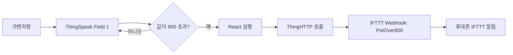

# 가변저항 값에 반응하는 IFTTT 알림

ThingSpeak에 기록되는 가변저항 값이 기준을 넘었을 때 휴대폰으로 알려주는 IoT 알림 프로젝트입니다. 센서값을 계속 화면으로 확인하지 않아도, ThingSpeak가 조건을 판단하고 IFTTT가 휴대폰 알림을 보내는 흐름으로 구성했습니다.

## 프로젝트 소개

가변저항의 값은 ThingSpeak 채널 `Field 1`에 기록됩니다. 값이 `800`보다 커지면 React가 조건을 감지하고, ThingHTTP가 IFTTT Webhooks 이벤트를 호출합니다. 마지막으로 IFTTT 앱이 휴대폰에 알림을 표시합니다.

이 프로젝트에서 제가 만든 핵심은 **센서값 기록, 기준값 판단, 휴대폰 알림을 각각 다른 서비스에 맡겨 연결한 것**입니다. Arduino를 연결하기 전에도 API 요청으로 시험값을 보낼 수 있어 각 단계가 동작하는지 확인하기 쉽습니다.

## 사용한 서비스와 항목

| 항목 | 역할 |
|---|---|
| 가변저항 | 측정할 값을 만듦 |
| ThingSpeak 채널 `3565693` | 가변저항 값을 `Field 1`에 기록 |
| ThingSpeak React | `Field 1 > 800` 조건을 검사 |
| ThingSpeak ThingHTTP | 조건이 맞으면 IFTTT Webhook 호출 |
| IFTTT Webhooks | 이벤트 `PotOver800`를 받음 |
| IFTTT 앱 | 휴대폰에 알림 표시 |

## 동작 흐름



## 구현 과정

### 1. IFTTT Applet

- **If This:** Webhooks → Receive a web request
- **Event Name:** `PotOver800`
- **Then That:** Notifications → Send a notification from the IFTTT app
- **알림 문구:** `가변저항 값이 800을 넘었습니다.`

이벤트 이름은 ThingHTTP URL에 적는 이름과 같아야 합니다. 휴대폰 IFTTT 앱은 같은 계정으로 로그인하고 알림을 허용합니다.

### 2. ThingSpeak ThingHTTP

ThingSpeak의 **Apps → ThingHTTP → New ThingHTTP**에서 다음 요청을 저장합니다.

| 항목 | 설정값 |
|---|---|
| Name | `IFTTT Pot Alert` |
| URL | `https://maker.ifttt.com/trigger/PotOver800/with/key/본인의_WEBHOOK_KEY` |
| Method | `GET` |

`본인의_WEBHOOK_KEY`는 IFTTT Webhooks의 Documentation에서 확인한 키로 직접 바꿉니다. 키가 들어간 실제 URL은 공개하지 않습니다.

### 3. ThingSpeak React

**Apps → React → New React**에서 조건과 실행 항목을 설정합니다.

| 항목 | 설정값 |
|---|---|
| Condition Type | Numeric |
| Test Frequency | On Data Insertion |
| Channel | 본인의 가변저항 채널 (`3565693`) |
| Field / Condition | Field 1 **is greater than** `800` |
| Action | ThingHTTP → `IFTTT Pot Alert` |
| Options | Run action each time condition is met |

`800`과 같은 값은 알림 조건에 포함되지 않습니다. 매번 실행 옵션을 선택하면 801 이상 값이 새로 기록될 때마다 React가 동작합니다.

### 4. API 요청으로 시험값 기록

ThingSpeak의 **Channels → API Keys**에서 Write API Key를 확인한 뒤, 아래 주소의 `WRITE_API_KEY`를 본인 키로 바꿔 브라우저에서 엽니다.

```text
https://api.thingspeak.com/update?api_key=WRITE_API_KEY&field1=801
```

응답으로 `0`보다 큰 기록 번호가 나오면 값이 저장된 것입니다. 기록 간격 제한 때문에 무료 계정에서는 요청 사이에 15초 이상 기다립니다. 그 뒤 채널 그래프와 휴대폰 알림을 확인합니다.

## 실행 확인

- 11월 25일 오후 11시 32분, IFTTT 앱의 Activity에 **Applet ran** 기록이 표시되었습니다.
- 실행 상세에는 Webhooks 이벤트 `PotOver800`이 발생했다고 표시됩니다.
- 이 기록으로 Webhooks 이벤트가 IFTTT Applet까지 전달된 것을 확인했습니다. 휴대폰 알림 배너가 보이지 않았다면 IFTTT 앱의 알림 권한과 휴대폰 알림 기록도 확인합니다.
## 주요 설정을 이렇게 한 이유

- **Numeric 조건:** `Field 1`을 숫자로 비교해 기준값보다 큰지 판단합니다.
- **On Data Insertion:** 새 값이 들어올 때마다 조건을 검사합니다.
- **800 초과:** 800은 제외되고 801부터 조건을 만족합니다.
- **이벤트명 일치:** IFTTT와 ThingHTTP의 이벤트명이 다르면 Webhook이 Applet을 실행하지 못합니다.

## 고찰

이번 작업을 하면서 센서값을 기록하는 것과 알림을 보내는 것은 한 번에 이루어지는 동작이 아니라 여러 서비스가 이어진 과정이라는 점을 확인했습니다. 그래서 문제가 생겼을 때 채널 기록, React 조건, ThingHTTP 요청, IFTTT 실행 기록 순서로 나누어 보면 어느 단계에서 멈췄는지 찾기 쉽습니다.

브라우저에서 `801`을 기록하는 방법은 실제 센서가 없어도 조건을 시험할 수 있다는 장점이 있습니다. 다음에는 Arduino가 가변저항 값을 주기적으로 채널에 보내도록 연결하고, IFTTT Activity와 휴대폰 알림까지 함께 확인해 실제 동작 과정을 완성해 보고 싶습니다.

## 참고 자료

- [ThingSpeak React 공식 문서](https://kr.mathworks.com/help/thingspeak/react-app.html)
- [ThingSpeak ThingHTTP 공식 문서](https://kr.mathworks.com/help/thingspeak/thinghttp-app.html)
- [ThingSpeak와 IFTTT 연결 문서](https://kr.mathworks.com/help/thingspeak/use-ifttt-to-send-text-message-notification.html)

> Write API Key와 IFTTT Webhook Key는 공개 저장소에 올리지 않습니다.
